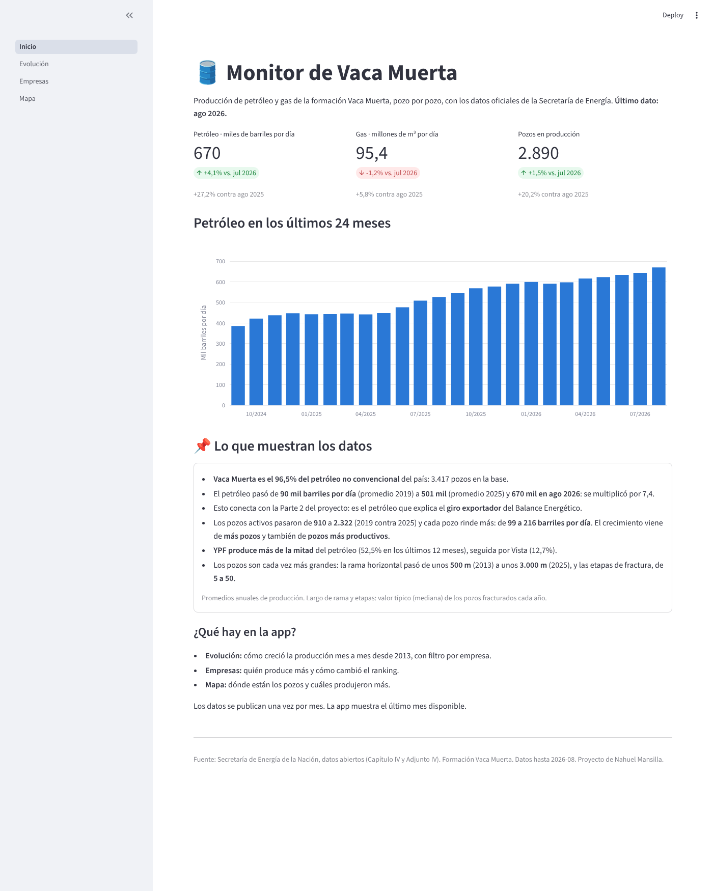

# Monitor de Vaca Muerta

Parte 3 del proyecto *Balance Energético de Argentina*
([Parte 2 en GitHub](https://github.com/Nahumanas/Analisis_Energetico_Argentina_2019_2024)): una app que muestra
la producción de Vaca Muerta pozo por pozo y se actualiza sola cada mes, más (próximamente) un modelo de
Machine Learning que estima la producción de un pozo según cómo se lo fracturó.

**👉 App online: https://monitor-vaca-muerta.streamlit.app/**



## Estado

| Etapa | Estado |
|---|---|
| 0. Sumar el Balance 2025 a la Parte 2 | ✅ Hecho |
| 1. Descargar y explorar producción y fracturas | ✅ Hecho (`notebooks/01_exploracion.ipynb`) |
| 2. Limpieza y archivos Parquet | ✅ Hecho (`scripts/procesar.py`, `notebooks/02_limpieza.ipynb`) |
| 3. App v1 en Streamlit | ✅ Hecho (`app/`) |
| 4. Actualización automática (GitHub Actions) | ✅ Hecho (`.github/workflows/actualizar_datos.yml`) |
| 5. Modelo de ML | Pendiente |
| 6. Simulador en la app | Pendiente |

## Cómo descargar los datos

Desde esta carpeta, en la terminal:

```
python scripts/descargar.py
```

Baja dos archivos del portal de la Secretaría de Energía a `datos/crudos/`:
- `produccion_no_convencional.csv`: producción mensual de cada pozo no convencional (~150 MB).
- `fracturas.csv`: cómo se fracturó cada pozo.

## Cómo procesar los datos

Después de descargar, desde esta carpeta:

```
pip install -r requirements.txt
python scripts/procesar.py
```

Limpia los CSV y genera en `datos/procesados/` los archivos Parquet que usa la app (~4 MB en total).
Cada decisión de limpieza está explicada en `notebooks/02_limpieza.ipynb`.

## Cómo abrir la app

Desde esta carpeta:

```
streamlit run app/Inicio.py
```

Se abre en el navegador (http://localhost:8501) con 4 páginas:

| Página | Qué muestra |
|---|---|
| Inicio | Producción del último mes, variación contra el mes y el año anterior, los últimos 24 meses y las conclusiones principales |
| Evolución | Petróleo y gas mes a mes desde 2013, con filtro por empresa y por años |
| Empresas | Ranking de empresas por petróleo o gas, y la evolución de las 5 principales |
| Mapa | Mapa interactivo de pozos, coloreados por producción acumulada |

La app lee los archivos de `datos/procesados/`. Para actualizarla con datos nuevos: `descargar.py` → `procesar.py` → volver a abrirla.

## Versión web (Next.js, para Vercel)

La carpeta `web/` tiene la misma app hecha con **Next.js** (React), lista para publicar en **Vercel**.
No usa Python: lee los JSON que `procesar.py` deja en `datos/procesados/web/` (los genera `scripts/exportar_web.py`).
Cada vez que se suben datos nuevos a GitHub (con `actualizar.bat` o GitHub Actions), Vercel vuelve a armar la web sola.

Para verla en tu PC (necesita [Node.js](https://nodejs.org) 20 o más nuevo):

```
cd web
npm install
npm run dev
```

y abrir http://localhost:3000.

Está hecha con **Tailwind CSS** (estilos), **Recharts** (gráficos) y **react-map-gl + MapLibre** (mapa, sin token).
Diseño "terminal": fondo negro, sin tarjetas (las secciones se separan con líneas finas), un solo color de acento
(naranja) y tres fuentes: Playfair Display (títulos), DM Sans (textos) e IBM Plex Mono (todos los números).
El botón "Claro" del menú pasa a un modo claro editorial (fondo tiza y azul petróleo).

| Archivo | Qué hace |
|---|---|
| `web/app/layout.tsx` + `web/components/layout/` | Esqueleto: menú superior con las pestañas y botón de tema |
| `web/app/page.tsx` | Panel general (KPIs, evolución, market share, hallazgos) |
| `web/app/evolucion/`, `empresas/`, `mapa/`, `predicciones/` | Las pestañas (los filtros están en los archivos `...Cliente.tsx`) |
| `web/components/DashboardKPIs.tsx` | Tarjetas de KPIs |
| `web/components/ProductionChart.tsx` | Gráfico de áreas de producción (con tooltip de datos extra) |
| `web/components/MainChart.tsx` | Gráfico principal: total o la empresa elegida, con hitos tecnológicos |
| `web/components/MarketShareRanking.tsx` | Ranking de market share: pasar el mouse o tocar una empresa la elige |
| `web/components/SmallMultiplesSync.tsx` | Gráficos chicos por empresa con tooltip sincronizado |
| `web/lib/store.ts` | Estado compartido (Zustand): qué empresa está elegida |
| `web/components/WellMap.tsx` | Mapa de pozos |
| `web/components/MLPredictionPanel.tsx`, `WellYieldPredictor.tsx` | Pestaña Predicciones ML |
| `web/components/ui/` | Piezas chicas reutilizables (secciones, etiquetas, slider...) |
| `web/lib/config.ts` | Interruptores, como el que muestra u oculta la pestaña de ML |
| `web/lib/datos.ts` | Lee los JSON |
| `web/lib/indicadores.ts` | Cálculo de KPIs y market share |
| `web/lib/ml.ts` | Contrato con la API del modelo (qué se manda y qué se recibe) |
| `web/app/api/ml-predictions/route.ts` | API de ejemplo: hoy devuelve un resultado **simulado** |
| `web/app/globals.css` | Colores del modo oscuro y claro |

### Predicciones ML (preparado para el modelo)

**Está oculta** hasta que el modelo esté listo: no aparece en el menú y `/predicciones` da "página no encontrada".
Para mostrarla: en Vercel → Settings → Environment Variables, crear `NEXT_PUBLIC_MOSTRAR_ML` = `true` y hacer
Redeploy. En la PC: crear `web/.env.local` con la línea `NEXT_PUBLIC_MOSTRAR_ML=true`.

La pestaña ya funciona, pero el número que muestra sale de una fórmula simple, no de un modelo.
Cuando el modelo esté entrenado en Python, hay que hacer una API (por ejemplo con FastAPI) que reciba
`POST {"rama_m": 2500, "etapas": 40}` y devuelva los campos de `RespuestaPrediccion` en `web/lib/ml.ts`,
y en Vercel cargar la variable `NEXT_PUBLIC_ML_API_URL` con la dirección de esa API. La web no cambia.

## Actualización automática

Todos los lunes, **GitHub Actions** corre `descargar.py` y `procesar.py` en los servidores de GitHub.
Si el Gobierno publicó datos nuevos, guarda los Parquet actualizados en el repo y la app online se actualiza sola.
También se puede correr a mano desde la pestaña **Actions → Actualizar datos → Run workflow**.

Desde el 19/10/2026 el portal de la Secretaría de Energía no responde a los servidores de GitHub. Si pasa eso,
la tarea termina con una advertencia y la app sigue mostrando los datos anteriores. Para actualizar desde una PC
en Argentina: `actualizar.bat` (descarga, procesa y sube los datos nuevos al repo).

## Fuentes

- [Producción de petróleo y gas por pozo](http://datos.energia.gob.ar/dataset/produccion-de-petroleo-y-gas-por-pozo)
- [Datos de fractura de pozos (Adjunto IV)](http://datos.energia.gob.ar/dataset/datos-de-fractura-de-pozos-adjunto-iv)
